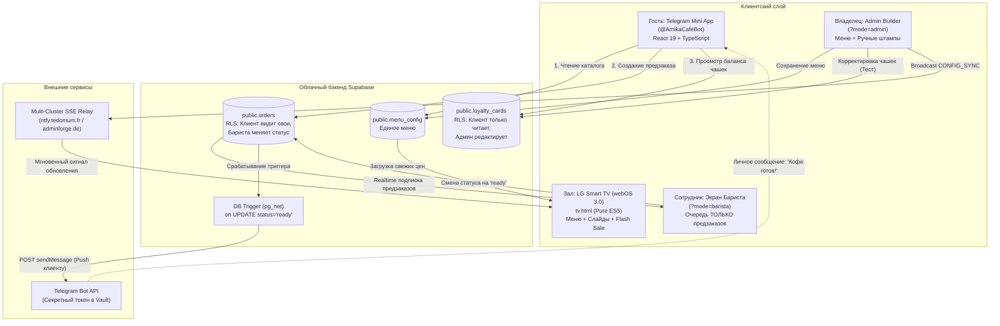

# Реестр архитектурных решений (Architecture Decision Records — ADR)

> **Проект:** Amika Café Digital Ecosystem  
> **Статус реестра:** Актуален  
> **Последнее обновление:** 24 октября 2026

---

## 🧭 Список принятых архитектурных решений

| ADR ID | Название решения | Статус | Дата | Влияние на систему |
| :--- | :--- | :--- | :--- | :--- |
| **[ADR-0001](file:///d:/Amika_Cafe/conductor/adr/0001-telegram-push-serverless-dispatch.md)** | **Защищенная серверная отправка Telegram Push через Supabase Database Webhook / pg_net** | Принято (Accepted) | 24.10.2026 | Изоляция секретного токена бота `@AmikaCafeBot`, гарантированная транзакционная доставка уведомлений о готовности заказа. |
| **[ADR-0002](file:///d:/Amika_Cafe/conductor/adr/0002-orders-loyalty-rls-security.md)** | **Схема данных и политики Row Level Security (RLS) для предзаказов и карт лояльности** | Принято (Accepted) | 24.10.2026 | Защита номеров телефонов, предотвращение накрутки бесплатных чашек, разграничение прав гостя, бариста и администратора. |
| **[ADR-0003](file:///d:/Amika_Cafe/conductor/adr/0003-unified-cloud-menu-source.md)** | **Единый облачный источник правды каталога меню через Supabase menu_config** | Принято (Accepted) | 24.10.2026 | Устранение десинхрона цен между TWA и ТВ, мгновенное распространение стоп-листа по SSE, сохранение оффлайн-кэша. |
| **[ADR-0004](file:///d:/Amika_Cafe/conductor/adr/0004-smart-tv-order-decoupling.md)** | **Полное разделение Smart TV меню-борда и системы управления заказами** | Принято (Accepted) | 24.10.2026 | Очистка экрана телевизора LG webOS 3.0 от фастфуд-очереди, фокус на эстетике меню и Foodberry, тихие пуши в Telegram. |
| **[ADR-0005](file:///d:/Amika_Cafe/conductor/adr/0005-store-catalog-admin-and-media-storage.md)** | **Архитектура админки витрины магазина, гибридного медиа-хранилища и сквозного стоп-листа** | На рассмотрении (Proposed) | 24.10.2026 | Вкладка «Витрина» в ?mode=admin, автосжатие фото (WebP <80KB) в Supabase Storage, единый мастер-каталог для ТВ, 1-клик стоп-лист бариста. |

---

## 🏗️ Сводная архитектурная диаграмма (Target Architecture)

