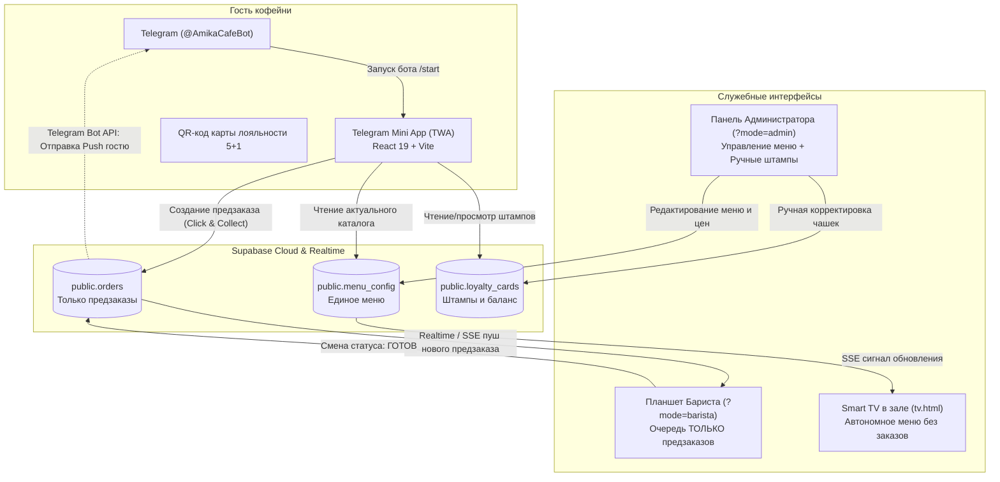

# Product Requirements Document (PRD): Amika Café Digital Ecosystem

> **Версия:** 1.0 (Draft for Approval)  
> **Дата:** 24 октября 2026  
> **Автор:** Евгений (Lead Engineer / Automation Developer)  
> **Стейкхолдер:** Владелец кофейни Amika Café (Крикова, Молдова)  
> **Статус документа:** На рассмотрении и согласовании (Этап 1: `prd-development`)

---

## 🧭 Навигация по документу

1. [Executive Summary](#1-executive-summary)
2. [Problem Statement](#2-problem-statement)
3. [Target Users & Personas](#3-target-users--personas)
4. [Strategic Context](#4-strategic-context)
5. [Solution Overview](#5-solution-overview)
6. [Success Metrics](#6-success-metrics)
7. [User Stories & Requirements](#7-user-stories--requirements)
8. [Out of Scope](#8-out-of-scope)
9. [Dependencies & Risks](#9-dependencies--risks)
10. [Open Questions & Assumptions](#10-open-questions)
11. [PRD Self-Assessment](#11-prd-self-assessment)

---

## 1. Executive Summary

Мы создаем **цифровую экосистему предзаказа и лояльности** на базе **Telegram Mini App (`@AmikaCafeBot`)**, облачной синхронизации **Supabase** и специализированного **терминала предзаказов бариста** для кофейни **Amika Café** в г. Крикова, чтобы решить проблему **утренних очередей, потери транзитных клиентов и рассинхронизации меню**. Это позволит клиентам получать свежий Specialty-кофе навынос менее чем за 30 секунд без очередей, бариста — оперативно готовить онлайн-предзаказы и информировать гостей персональными push-уведомлениями в Telegram прямо в момент готовности, а владельцу — централизованно управлять единым каталогом цен и стоп-листом одновременно для гостей и экрана в зале.

> **One-Sentence Elevator Pitch:**  
> «Мы внедряем мобильный предзаказ Click & Collect в Telegram с персональными push-уведомлениями о готовности, единым облачным меню и цифровой штамп-картой 5+1, превращая спешащих утренних пешеходов Крикова в постоянных лояльных гостей кофейни Amika Café».

---

## 2. Problem Statement

### Кто сталкивается с проблемой?
1. **Спешащие утренние гости Крикова:** жители городка, выезжающие на работу или учебу в Кишинев между 07:30 и 09:30, паркующиеся у Linella / Farmacia Familiei на 5–10 минут или спешащие на общественный транспорт.
2. **Бариста / Владелец за стойкой:** работающий в одиночку в утренний пик, разрывающийся между приемом заказов, расчетом на кассе и взбиванием молока.

### В чем заключается проблема?
- **Потеря транзитной выручки в утренний час пик:** Клиент видит очередь из 3–4 человек у стойки и понимает, что ждать 7–10 минут он не успевает (уедет маршрутка или опоздает в офис). В итоге он отказывается от покупки качественного Specialty-кофе и уходит без напитка или покупает суррогат на заправке.
- **Рассинхронизация цен и стоп-листа:** В текущем прототипе меню клиентов захардкожено в статическом коде, а ТВ-борд питается из Supabase. При смене цен или окончании миндальных круассанов Foodberry бариста вынужден предупреждать каждого гостя голосом, что вызывает раздражение.
- **Шум и неудобство выдачи:** В зале кофейни звучит музыка, работает кофемолка. Голос бариста «Капучино для Михая!» часто не слышен, а вывод номеров заказов на эстетичный Smart TV превращает камерную атмосферу кофейни в фастфуд.
- **Устаревшие бумажные карты лояльности:** Карточки «каждый 6-й кофе бесплатно» мнутся, теряются в карманах и забываются дома. Кофейня теряет оцифрованную базу постоянных гостей.

### Последствия (Pain Points)
- **Для клиента:** Потеря времени, стресс от опоздания, упущенная чашка любимого утреннего кофе, досада от забытой дома штамп-карты.
- **Для бизнеса:** Потеря до 20–30% потенциальной утренней выручки, упущенная выгода от списания нераспроданных крафтовых десертов Foodberry, отсутствие прямой цифровой связи с гостями для повторных продаж.

### Факты и свидетельства (Evidence)
- **Локация:** Amika Café расположена на узловом пятачке Крикова (ул. Друмул Виилор 10 / Кишинэулуй) рядом с крупнейшим супермаркетом Linella — естественный транзитный хаб города.
- **Практика за стойкой:** Владелец лично подтверждает пиковую нагрузку с 08:00 до 09:30, когда бариста физически не успевает одновременно пробивать чек, наливать молоко и рассказывать состав десертов.
- **Существующая база:** В Telegram зарегистрирован официальный бот `@AmikaCafeBot` (токен валидирован через Telegram Bot API), готовый стать персональным шлюзом к каждому гостю.

---

## 3. Target Users & Personas

### Первичная персона: «Спешащий Ион» (Транзитный гость)
- **Возраст:** 29 лет, маркетолог / инженер, живет в Крикова, работает в центре Кишинева.
- **Контекст:** Выходит из дома в 08:05, в 08:15 садится в машину или на транспорт. В запасе ровно 5 минут.
- **Цели:** Быстро получить любимый Flat White на овсяном молоке и свежий круассан Foodberry, не теряя ни секунды в очереди.
- **Боли:** Очередь на кассе, необходимость доставать кошелек и ждать терминал, забытая бумажная карта лояльности.
- **Поведение:** Активный пользователь смартфона, ценит Telegram за скорость и отсутствие спама.

### Вторичная персона: «Бариста за стойкой» (Мария / Владелец)
- **Контекст:** Работает в утреннюю смену. В зале — поток заказов у стойки, в телефоне/планшете — онлайн-предзаказы.
- **Критическое требование:** Экран бариста должен показывать **ТОЛЬКО онлайн-предзаказы из Telegram**. Заказы гостей у кассы пробиваются через кассовый терминал и **НЕ должны засорять экран предзаказов**.
- **Цели:** Видеть список предзаказов ко времени (например, «к 08:20»), вовремя сварить кофе, нажать одну кнопку «Готов» и забыть — система сама уведомит гостя.

### Третичная персона: «Администратор / Владелец»
- **Контекст:** Контролирует меню, цены, остатки десертов и акции.
- **Цели:** В один клик поменять цену на зерно или десерт в `AdminBuilder`, и чтобы это изменение одновременно применилось в мобильном боте гостя и на ТВ-борде.
- **Специфическая потребность:** Возможность в ручном режиме начислять или корректировать штампы лояльности конкретному гостю (для тестов и сервисных ситуаций).

### Jobs-to-be-Done (JTBD)
- **Функциональная задача:** *«Когда я еду на работу, я хочу за 2 минуты до приезда оформить предзаказ и оплатить его через MIA, чтобы забрать готовый горячий кофе сразу при входе»*.
- **Эмоциональная задача:** *«Чувствовать себя привилегированным постоянным гостем, ценящим свое время, а не стоять в очереди»*.
- **Социальная задача:** *«Быть частью комьюнити любителей правильного спешелти-кофе в родном городе»*.

---

## 4. Strategic Context

### Бизнес-цели и эффект
- **Рост выручки кофейни на 15–25%** за счет привлечения транзитной утренней аудитории, которая сейчас проходит мимо из-за очередей.
- **Увеличение LTV постоянных клиентов** благодаря понятной цифровой карте «5+1» (каждая 6-я чашка в подарок).
- **Снижение списаний по десертам Foodberry** за счет вечерних точечных акций (Flash-Sale).

### Конкурентная среда и дифференциация
В Крикова отсутствуют сетевые кофейни с собственными приложениями предзаказа (уровень Tucano / Coffee Like / Starbucks). Внедрение Telegram Mini App дает Amika Café технологическое лидерство в локации без необходимости заставлять пользователей скачивать тяжелые приложения из App Store / Google Play.

### Почему именно сейчас?
1. Владелец кофейни открыт к инновациям и сам заинтересован в разгрузке утренней стойки.
2. Телевизор в зале уже подключен к автономному Live Board (`tv.html`).
3. Бот `@AmikaCafeBot` создан и готов к интеграции.
4. В Молдове набрала огромную популярность система **MIA Plăți Instant**, позволяющая принимать оплату по номеру телефона без эквайринговых комиссий и терминалов.

---

## 5. Solution Overview

### Архитектурные принципы решения:
1. **Единый источник истины меню (Single Menu Source):**  
   Клиентский TWA и TV Board загружают каталог из единой таблицы `menu_config` в Supabase. Локальный статический файл `products.ts` переводится в роль оффлайн-фоллбэка.
2. **Изоляция потока предзаказов (Strict Pre-order Scope):**  
   Экран бариста (`BaristaScreen.tsx`) предназначен **исключительно для онлайн-предзаказов из Telegram**. Заказы из зала пробиваются бариста на кассе и не вносятся в веб-приложение, исключая дублирование работы.
3. **Персональные уведомления вместо ТВ-экрана (Direct Telegram Push):**  
   Статус готовности заказа (`#102`) **НЕ выводится на телевизор в зале**. Вместо этого при нажатии кнопки «Готов» на экране бариста вызывается Telegram Bot API, и бот `@AmikaCafeBot` отправляет персональное сообщение клиенту:  
   > *«☕ Михай, ваш заказ #102 (Капучино + Круассан) готов! Ждем вас у стойки Amika Café»*.
4. **Цифровая штамп-карта «5+1»:**  
   Штампы привязаны к `telegram_user_id`. Клиент предъявляет QR-код с экрана телефона. В панели администратора предусмотрен служебный блок ручного начисления/списания чашек для тестирования и клиентской поддержки.
5. **Чистый Smart TV без шума:**  
   С экрана телевизора `tv.html` удаляется строка очереди заказов («Gata de ridicare»), превращая его в стильный, премиальный имиджевый экран: Specialty-кофе, выпечка Foodberry, сезонные слайды и QR-код для запуска бота.

---

## 6. Success Metrics

| Метрика | Описание | Базовое значение | Целевой ориентир | Период замера |
| :--- | :--- | :--- | :--- | :--- |
| **Основная метрика (North Star)** | Доля утренних предзаказов (07:30–09:30) через `@AmikaCafeBot` от общего числа утренних чеков | 0% (предзаказа нет) | **>= 20%** | 30 дней после запуска |
| **Время выдачи предзаказа** | Время с момента входа гостя в кофейню до получения готового стакана | 5–8 минут (в очереди) | **< 30 секунд** (взял и пошел) | Постоянно |
| **Синхронность меню** | Задержка между сохранением цены в админке и обновлением у клиента и на ТВ | Не синхронизировано (ручной билд) | **< 3 секунд** | При каждом апдейте |
| **Доходимость до подарка (Loyalty)** | Процент активных гостей, достигших 6-й чашки (бесплатного напитка) | 0% (карты теряются) | **>= 35%** | 60 дней |
| **Guardrail (Безопасность)** | Скорость работы бариста на кассе зала | Нет помех | **0 задержек** (бариста не отвлекается на лишний ввод) | Постоянно |

---

## 7. User Stories & Requirements

### Эпическая гипотеза (Epic Hypothesis)
> *Мы уверены, что предоставление спешащим горожанам Крикова возможности оформить предзаказ к точному времени в Telegram с мгновенным push-уведомлением о готовности приведет к росту утренних продаж на 20%, потому что устранит главный барьер утренней очереди. Подтверждением успеха станет достижение 50+ регулярных утренних предзаказов в неделю через `@AmikaCafeBot` в первый месяц.*

---

### Epic 1: Единый облачный каталог меню (Unified Catalog)

#### US-1.1: Загрузка актуального меню в гостевом Mini App
- **Как** гость кофейни, открывающий Telegram Mini App,
- **Я хочу** видеть свежие цены, описания и статус доступности напитков и десертов из облачной базы,
- **Чтобы** не заказывать позиции, которых нет на витрине, и видеть честную стоимость.
- **Acceptance Criteria:**
  - [ ] При старте TWA запрашивает актуальный конфиг из Supabase `menu_config` (row `id = 'current'`).
  - [ ] Если позиция помечена как скрытая (`visible: false`), она не отображается в каталоге клиента.
  - [ ] Двойные цены (Solo / Doppio) и объемы корректно отображаются и выбираются в карточке товара.
  - [ ] При отсутствии интернета приложение мягко загружает кэшированное локальное меню без падения экрана.

---

### Epic 2: Онлайн-предзаказ Click & Collect

#### US-2.1: Оформление предзаказа к времени
- **Как** спешащий утренний гость,
- **Я хочу** набрать напитки в корзину, указать время забора (+5, +10, +15 мин), имя и способ оплаты (MIA или на кассе),
- **Чтобы** бариста приготовил напиток ровно к моему прибытию.
- **Acceptance Criteria:**
  - [ ] В корзине гость выбирает время готовности: «Через 5 минут (Уже иду)», «Через 10 минут», «Через 15 минут».
  - [ ] Выбор способа оплаты: «MIA Plăți Instant» (с выводом номера телефона и кнопки быстрого перевода) или «При получении».
  - [ ] Данные заказа валидируются и записываются в таблицу `public.orders` в Supabase.
  - [ ] Заказ содержит `telegram_user_id`, имя, телефон, состав, опции (молоко/сироп), сумму и статус `'new'`.
  - [ ] Гостю отображается экран подтверждения с крупным номером заказа (напр. `#105`).

---

### Epic 3: Терминал предзаказов бариста и Telegram Push-уведомления

#### US-3.1: Прием и ведение предзаказа на экране бариста
- **Как** бариста кофейни,
- **Я хочу** видеть на планшете список поступающих онлайн-предзаказов со звуковым сигналом и временем готовности,
- **Чтобы** своевременно сварить нужный кофе и не держать клиента у стойки.
- **Acceptance Criteria:**
  - [ ] Экран `?mode=barista` слушает поступление новых заказов из Supabase в реальном времени.
  - [ ] В списке отображаются **только онлайн-предзаказы**. Заказы из зала в список не попадают.
  - [ ] Каждая карточка содержит: номер заказа, имя клиента, желаемое время, обратный отсчет, состав и опции кастомизации.
  - [ ] При появлении нового заказа воспроизводится звуковой сигнал.

#### US-3.2: Отправка персонального Telegram Push при готовности
- **Как** бариста, закончивший приготовление заказа,
- **Я хочу** нажать кнопку «Готов к выдаче»,
- **Чтобы** гостю в личные сообщения в Telegram мгновенно пришло оповещение, что его кофе ждет на стойке.
- **Acceptance Criteria:**
  - [ ] При нажатии кнопки «Готов» статус заказа в Supabase переходит в `'ready'`.
  - [ ] Инициируется отправка сообщения через Telegram Bot API (`@AmikaCafeBot`) на `telegram_user_id` гостя.
  - [ ] Шаблон сообщения двуязычный (по языку гостя):  
    *RO:* `☕ [Имя], comanda ta #[Номер] este gata! Te așteptăm la tejgheaua Amika Café.`  
    *RU:* `☕ [Имя], ваш заказ #[Номер] готов! Ждем вас у стойки Amika Café.`
  - [ ] Номер заказа **не выводится на телевизор в зале**.
  - [ ] При нажатии «Выдан» заказ архивируется со статусом `'completed'`.

---

### Epic 4: Цифровая штамп-карта лояльности «5+1»

#### US-4.1: Персональная штамп-карта гостя в Telegram
- **Как** постоянный гость,
- **Я хочу** видеть в Telegram Mini App свой баланс штампов (например, 3 из 5) и уникальный QR-код,
- **Чтобы** не носить бумажную карточку и копить на бесплатный 6-й кофе.
- **Acceptance Criteria:**
  - [ ] Карта лояльности привязана к `telegram_user_id` гостя.
  - [ ] На экране отображаются визуальные слоты чашек (1..5) и подарочная 6-я чашка.
  - [ ] Отображается персональный QR-код гостя, содержащий зашифрованный ID карты.

#### US-4.2: Ручное управление штампами в панели Администратора
- **Как** администратор кофейни,
- **Я хочу** иметь в панели `?mode=admin` инструмент для ручного добавления/списания чашек по номеру карты или Telegram ID,
- **Чтобы** тестировать механику лояльности и начислять бонусы гостям при необходимости.
- **Acceptance Criteria:**
  - [ ] В админ-панели есть закрытый PIN-кодом раздел «Управление лояльностью (Тест/Админ)».
  - [ ] Администратор может ввести ID карты или выбрать клиента из списка и вручную изменить количество штампов (от 0 до 6).
  - [ ] Изменения мгновенно сохраняются в таблице `loyalty_cards` в Supabase и отображаются у гостя при обновлении.

---

### Epic 5: Редизайн Smart TV меню-борда (Чистый зал)

#### US-5.1: Автономный эстетичный ТВ-экран
- **Как** гость в зале кофейни,
- **Я хочу** видеть на большом телевизоре актуальное меню, цены, сезонные напитки и витрину Foodberry,
- **Чтобы** выбрать напиток в спокойной и красивой обстановке.
- **Acceptance Criteria:**
  - [ ] Из `public/tv.html` полностью удален блок/строка очереди заказов («Gata de ridicare»).
  - [ ] Освободившееся пространство перераспределено в пользу читаемости цен и слайдера крафтовых десертов Foodberry.
  - [ ] Сохранена 100% совместимость с LG webOS 3.0 (Chromium 38, чистый ES5, XHR, No-Cache).
  - [ ] Синхронизация цен и стоп-листа по SSE из Supabase работает без перезагрузки экрана.

---

## 8. Out of Scope (Что мы НЕ делаем в этом релизе)

1. **Заказы у стойки в зале:** Заказы от людей, подошедших к кассе в зале, пробиваются бариста через физический кассовый терминал и **не заносятся в систему**. В приложении живут только предзаказы.
2. **Вывод статусов заказов на Smart TV:** Никакие номера заказов, имена или звуковые гонги выдачи не транслируются на телевизор в зале. Оповещение идет строго лично в Telegram.
3. **Фоновое интернет-радио на ТВ (TRK-009):** Отложено до подбора стабильного потока или механизма воспроизведения локального аудиофайла кофейни.
4. **Интеграция с 1С:** Бухгалтерский учет ведется постфактум на аутсорсе, прямой API-мост с 1С в данном релизе исключен.
5. **Банковский интернет-эквайринг (Visa/Mastercard card-not-present):** Оплата онлайн производится через национальную систему **MIA Plăți Instant** (без комиссий и эквайринговых договоров), либо наличными/картой на кассе при выдаче.

---

## 9. Dependencies & Risks

### Внешние зависимости (Dependencies)
1. **Telegram Bot API:** Используется официальный бот `@AmikaCafeBot` (токен `8935606630:AAHf5kRs...`, работоспособность подтверждена).
2. **Supabase Cloud PostgreSQL:** Таблицы `menu_config`, `orders`, `loyalty_cards` (проект `ildagazsbdtgjlzlkfaq.supabase.co`).
3. **GitHub Pages CDN:** Раздача статического бандла TWA и `tv.html`.
4. **Multi-Cluster SSE Relay:** Резервные брокеры ntfy (`tedomum.fr`, `adminforge.de`, `ntfy.sh`) для мгновенного сигнала синхронизации.

### Риски и стратегии их снижения (Risks & Mitigations)
- **Риск 1: Бариста пропустит предзаказ в запарке у стойки.**  
  *Митигация:* Громкий повторяющийся звуковой алерт в браузере бариста при статусе `'new'`, цветовая индикация (мигающая плашка), таймер обратного отсчета до времени забора.
- **Риск 2: Клиент заблокировал бота или не нажал `/start`.**  
  *Митигация:* TWA запускается прямо внутри бота через кнопку WebApp — `chat_id` клиента автоматически доступен через `window.Telegram.WebApp.initDataUnsafe.user.id`.
- **Риск 3: Специфика устаревшего Smart TV (LG webOS 3.0 / Chromium 38).**  
  *Митигация:* Полная изоляция `tv.html` от React-бандла, только синтаксис ES5, строгий запрет на ES6+ код, заголовки No-Cache.

---

## 10. Open Questions & Assumptions

### 🔶 Зафиксированные допущения (Assumptions)
- 🔶 **A-1:** *Клиенты охотно соглашаются переводить оплату через MIA Plăți Instant по номеру телефона либо оплачивать на месте при получении без необходимости ввода данных кредитной карты.* (Основано на молдавских потребительских привычках 2025–2026 гг.).
- 🔶 **A-2:** *У бариста на стойке есть устройство с постоянным доступом в интернет (планшет, смартфон или ноутбук рядом с кассой) для открытия экрана `?mode=barista`.*
- 🔶 **A-3:** *Текущего бесплатного лимита Supabase (PostgreSQL + Realtime) и лимитов Telegram Bot API с запасом хватит для объема заказов одной крафтовой кофейни.*

### 🔵 Открытые вопросы (Open Questions)

| # | Вопрос | Ответственный | Срок решения | Статус |
| :--- | :--- | :--- | :--- | :--- |
| **Q-1** | Нужен ли бариста функционал отмены заказа с указанием причины (например, «закончилось овсяное молоко») с уведомлением клиента в Telegram? | Евгений / Владелец | Этап 2 (ADR) | 🔵 Открыт |
| **Q-2** | Будет ли Telegram Bot отправлять push через Supabase Edge Functions (серверный вебхук) или напрямую через вызов Bot API с клиента бариста? | Lead Engineer | Этап 2 (ADR) | 🔵 Решается в ADR |
| **Q-3** | Требуется ли звуковой сигнал для клиента внутри Telegram при изменении статуса заказа? | PM / UX | Этап 2 (ADR) | 🔵 Открыт |

---

## 11. PRD Self-Assessment

### Самый сильный раздел:
- **Раздел 5 (Solution Overview) и Раздел 7 (User Stories):** Максимально четко разграничены зоны ответственности. Устранена путаница с заказами из зала: бариста видит только предзаказы из Telegram, гости получают личные push-уведомления, а Smart TV очищен от фастфуд-номеров и работает как премиальный бордер меню.

### Раздел, требующий внимания на следующем этапе:
- **Раздел 9 (Dependencies / Architecture):** Способ отправки сообщений в Telegram Bot API при смене статуса заказа бариста (клиентский fetch к Telegram API против серверной функции Supabase Edge Function). Этот выбор будет формализован в следующем этапе через **ADR**.

### Рекомендуемый следующий шаг:
- **Утверждение настоящего PRD пользователем**, после чего — переход к **Этапу 2: Выбор архитектуры через `architecture-decision-records` (ADR)**.
