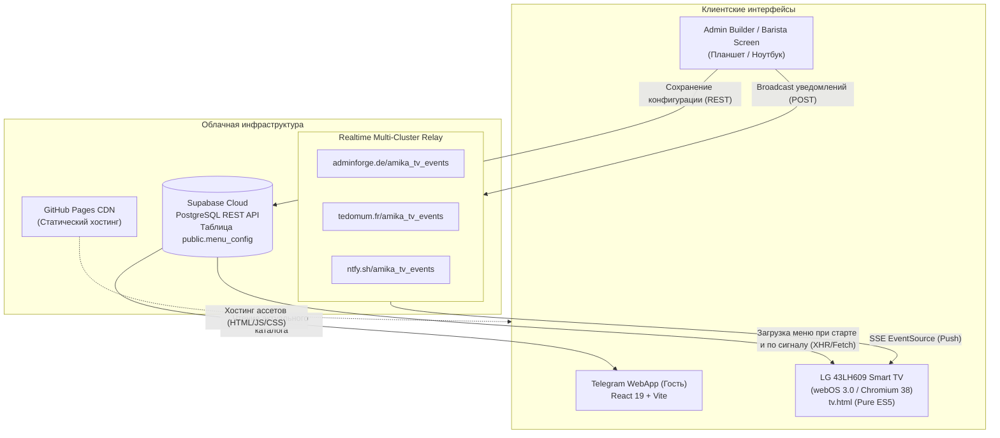

# Технологический стек и архитектура: Amika Café (tech-stack.md)

> **Статус:** Актуальный срез архитектуры и производственных зависимостей проекта.

---

## 1. Архитектурная диаграмма системы



---

## 2. Основной стек технологий

| Компонент | Технология | Версия | Обоснование выбора |
| :--- | :--- | :--- | :--- |
| **UI Framework** | React | `^19.0.0` | Быстрый рендеринг, декларативные модалки, современный стандарт SPA |
| **Language** | TypeScript | `^5.7.2` | Строгая типизация моделей меню, корзины, опций и цен |
| **Build Tool** | Vite | `^6.2.0` | Мгновенный HMR при разработке, компактные бандлы для мобильного TWA |
| **Styling** | Tailwind CSS | `^4.0.0` | Высокая скорость верстки, минимальный размер сгенерированного CSS |
| **Icons** | Lucide React | `^1.16.0` | Красивые контурные SVG-иконки для кофе, выпечки и статусов |
| **Cloud Database** | Supabase PostgreSQL | v2 REST API | Бесплатный надежный облачный бэкенд без необходимости держать свой VPS |
| **Hosting & CI/CD** | GitHub Pages | Branch `gh-pages` | Бесплатный CDN, мгновенный деплой коммитов |
| **Realtime Pub/Sub** | ntfy (Self-hosted & public) | SSE протокол | Надежная шина событий, работает через Server-Sent Events без WebSockets |

---

## 3. Критические архитектурные требования и специфика оборудования

### 1. Smart TV LG 43LH609 (webOS 3.0 / Chromium 38)
- **Ограничения платформы:** Встроенный браузер базируется на устаревшем движке Chromium 38 (2014-2015 года выпуска). В нем **отсутствуют**:
  - `fetch` API и `Promise` (в полном объеме);
  - ES6 стрелочные функции, `let`/`const`, шаблонные строки (template literals \`\`);
  - CSS Grid (работает только старый Flexbox);
  - Поддержка современных TLS/SSL шифров у некоторых websocket-серверов.
- **Инженерное решение (`public/tv.html`):**
  - Реализован как **абсолютно автономный файл** без зависимости от React или сборщика Vite.
  - Написан на **чистом ES5 JavaScript** (`var`, анонимные функции `function() {}`, конкатенация строк через `+`).
  - Все сетевые запросы используют чистый `XMLHttpRequest` (XHR) с обработкой `onreadystatechange`.
  - Защита от агрессивного кэширования браузера webOS:
    - Мета-теги `Cache-Control: no-cache, no-store, must-revalidate`.
    - Добавление динамического timestamp `?_t=` ко всем XHR-запросам к Supabase.

### 2. Multi-Cluster SSE Relay (Отказоустойчивость вещания)
Для моментальной отправки изменений из админки на телевизор используется брокер сообщений на базе SSE:
- Первичный узел: `https://adminforge.de/amika_tv_events`
- Резервный узел 1: `https://tedomum.fr/amika_tv_events`
- Резервный узел 2: `https://ntfy.sh/amika_tv_events`

Административная панель при сохранении меню отправляет HTTP POST запрос параллельно во все три кластера (`CONFIG_SUPABASE_SYNC`). Телевизор слушает SSE и при получении сигнала за 0.5 секунды перезапрашивает свежий JSON из Supabase.

### 3. Структура базы данных Supabase

- **Таблица:** `public.menu_config`
- **Строка конфигурации:** `id = "default"`
- **Поля:**
  - `id`: `text` (primary key, `"default"`)
  - `data`: `jsonb` (содержит полный массив категорий, позиций, цен, стоп-листа и настроек бегущей строки)
  - `updated_at`: `timestamptz` (время последней фиксации)
  - `version`: `int8` (инкрементный счетчик ревизий)
- **RLS Политики:** Чтение разрешено анонимным ключом (`anon public`), запись — авторизованным запросам или через админ-панель.

---

## 4. Модель данных двойных цен (Dual Pricing Schema)

Для напитков с разными дозировками (например, Espresso Solo / Dublu) модель данных в TypeScript расширена:

```typescript
export interface Product {
  id: string;
  name: { ro: string; ru: string };
  description: { ro: string; ru: string };
  price: number;              // Базовая цена (Single / Solo)
  secondPrice?: number;        // Вторая цена (Double / Dublu)
  volume: string;              // Базовый объем (напр. '40 ml' или '40 / 80 ml')
  secondVolume?: string;       // Второй объем (напр. '80 ml')
  category: ProductCategory;
  imageUrl?: string;
  isPopular?: boolean;
  isAvailable?: boolean;       // Статус стоп-листа
  options?: ProductOptions;    // { dose?: boolean, milk?: boolean, syrup?: boolean }
}
```
