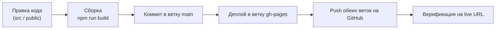

# Рабочие процессы и стандарты разработки: Amika Café (workflow.md)

> **Стандарт инженерии:** Регламент внесения изменений, тестирования, сборки, деплоя и коммуникации в проекте Amika Café.

---

## 1. Фундаментальный закон инженерии: Evidence Before Claims

> [!IMPORTANT]
> **Железное правило (Iron Law):** Категорически запрещено утверждать пользователю «Все готово», «Ошибка исправлена» или «Цены обновлены» без свежего, подтвержденного вывода консольных команд, тестов или сетевых запросов.
> Любое утверждение должно сопровождаться реальным фактом проверки.

---

## 2. Git-процесс и версионирование

Проект использует две ключевые ветки в GitHub-репозитории:
1. `main` — исходный код проекта, React-компоненты, стили, документация (`conductor/`).
2. `gh-pages` — скомпилированный production-бандл (содержимое папки `dist/` + корень `tv.html`), с которого GitHub Pages раздает статику.

### Соглашения о коммитах (Conventional Commits)
- `feat:` — добавление новой функциональности (например, `feat: add dual pricing to admin builder`).
- `fix:` — исправление багов (например, `fix: prevent webOS Chromium 38 caching with no-cache headers`).
- `docs:` — обновление паспорта проекта или документации (`docs: initialize conductor project passport`).
- `style:` — правки форматирования, CSS, верстки.
- `refactor:` — улучшение структуры кода без изменения поведения.

---

## 3. Регламент сборки и деплоя (Release Checklist)

При любых изменениях в коде или статических файлах выполняется строгая последовательность шагов:



### Команды в PowerShell:

```powershell
# 1. Сборка проекта
npm run build

# 2. Фиксация в основной ветке main
$git = "C:\Users\Евгений\AppData\Local\GitHubDesktop\app-3.6.7\resources\app\git\cmd\git.exe"
& $git add -A
& $git commit -m "feat: description of changes"
& $git push origin main

# 3. Деплой бандла в gh-pages
# Файлы из dist/ копируются в корень ветки gh-pages и публикуются
```

---

## 4. Специфика тестирования для webOS TV (`tv.html`)

При редактировании файла `public/tv.html` действуют особые правила:

1. **Запрет современного синтаксиса:**
   - Никаких `let`, `const`, `=>`, `async/await`, `class`, шаблонных строк \`${}\`.
   - Только синтаксис ES5: `var`, `function() {}`, `'string ' + var`.
2. **Проверка сетевых запросов:**
   - Использовать только `new XMLHttpRequest()`.
   - Обязательно передавать параметр `_t = new Date().getTime()` для исключения кэширования ответов.
3. **Проверка верстки:**
   - Избегать `display: grid`. Использовать `display: flex`, процентные ширины `calc()` и `inline-block`.
   - Цены с дробью должны иметь класс со свойством `white-space: nowrap;` во избежание некрасивого переноса второй цены на новую строку.

---

## 5. Регламент уведомлений в Telegram

Согласно глобальным правилам пользователя (`RULE[user_global]`), по завершении любой задачи или при необходимости задать уточняющий вопрос обязательно отправляется оповещение в Telegram владельца кофейни:

```powershell
# При завершении задачи:
python C:\Users\Евгений\.gemini\telegram_notifier.py --done "Краткая суть выполненной задачи" --details "Ключевые детали и ссылки"

# Если задача связана с ботом / сайтом:
python C:\Users\Евгений\.gemini\telegram_notifier.py --done "Текст" --details "https://jeneaa81.github.io/amika-cafe/"
```
